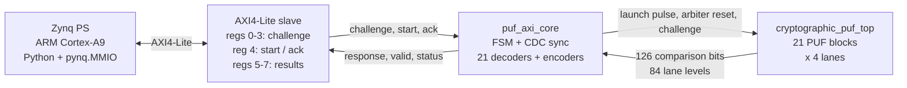
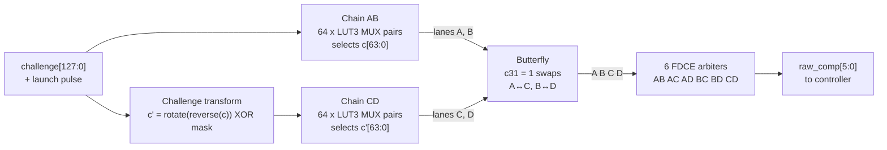
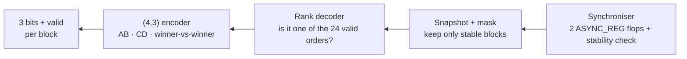
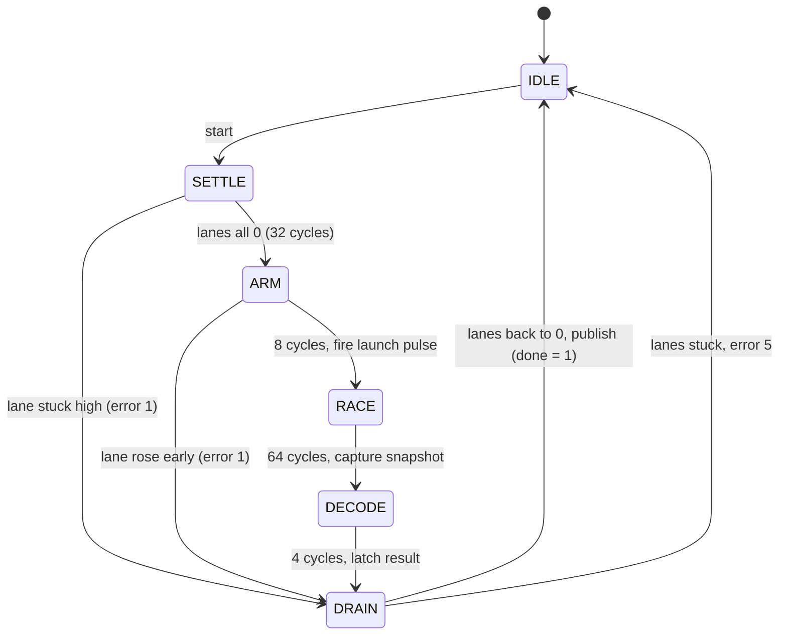

# 🔐 4-Lane Arbiter PUF Array on PYNQ-Z2

> **One pulse, four racing lanes, six flip-flop referees, 63 bits of silicon fingerprint.**


-blue)


A **Physically Unclonable Function (PUF)** turns tiny, random manufacturing differences inside a chip into a repeatable digital fingerprint. Copying the design does not copy the fingerprint.

This repo implements a **21-block, 4-lane arbiter PUF** in the programmable logic of a Zynq-7020. A 128-bit challenge goes in over AXI4-Lite, and a **63-bit response** plus per-block valid flags come out, all driven from Python on the board.

---

## ✨ Highlights

- **4 lanes per block.** Two 64-stage LUT3 multiplexer chains race a single launch pulse.
- **Butterfly crossover.** One challenge bit can swap the two chains before they are compared.
- **6 pairwise arbiters.** FDCE flip-flops record the complete finishing order of the four lanes.
- **Hardware consensus decoder.** Contradictory orderings (A < B < C < A) are detected on chip and flagged invalid.
- **(4,3) rank encoder.** Each block compresses its race into 3 response bits.
- **Self-checking controller.** A state machine runs every evaluation and reports one of 7 error codes.
- **Plug-and-play AXI4-Lite IP.** It is driven from Jupyter with `pynq.MMIO`.

---

## 📊 First results (single board, `PUF_2.bit`)

| Metric | Result | Ideal |
|---|---|---|
| Reliability | **99.17 %** (0.83 % bit flips) | 100 % |
| Uniformity | **46.43 %** | 50 % |
| Failed transactions | **0 / 512** | 0 |
| Uniqueness | *not measured yet* | 50 % |

Reliability is already strong. **Per-bit bias is the main open problem**: individual response bits range from 3.5 % to 99.4 % ones (see [Roadmap](#-roadmap)).

---

## 🧭 System block diagram



## 🏁 Inside one PUF block



Each chain stage is a classic arbiter-PUF switch. Select `0` passes both signals straight, select `1` crosses them:

```
        stage 0        stage 1               stage 63
 ┌──►[MUX]──────►[MUX]──────►  · · ·  ──►[MUX]──► lane A
 │       ╲      ╱    ╲      ╱                ╲  ╱
 │        ╲    ╱      ╲    ╱                  ╳
 │        ╱    ╲      ╱    ╲                 ╱  ╲
 └──►[MUX]──────►[MUX]──────►  · · ·  ──►[MUX]──► lane B
 ▲      c0            c1                   c63
 launch
```

## 🔁 From race to response (in the controller)



## ⏱️ Controller state machine



One evaluation takes about **141 clock cycles** (~1.4 µs at a 100 MHz PL clock).

---

## 🧩 Modules

### `PUF.v`: the race fabric (asynchronous)

| # | Module | What it does |
|---|---|---|
| 1 | `arbiter_chain` | 64-stage race track for two lanes, built from `LUT3` MUX pairs (`DONT_TOUCH` so Vivado keeps every stage). |
| 2 | *challenge transform* | Gives chain CD a scrambled challenge: bit-reverse, rotate by `(7·BLOCK_ID mod 31) + 5`, XOR a per-block mask. |
| 3 | *butterfly* | Challenge bit 31 swaps the two chains' lanes before comparison. |
| 4 | `xnor_xor_filter` | One `FDCE` arbiter. One lane drives D and the other drives the clock, so the flop records who arrived first. It is cleared by an independent reset. |
| 5 | `pairwise_matrix` | Six arbiters that compare every pair of lanes and output `raw_comp[5:0]`. |
| 6 | `pairwise_rank_decoder` | Tests the 6 bits against all 24 strict orderings. A block is valid only if the result is consistent and unambiguous. |
| 7 | `arbiter_4_3` | Encodes the order into 3 bits: winner of A/B, winner of C/D, and which of those two won. |
| 8 | `puf_structural_top` | One complete block: chains, transform, butterfly and arbiters. |
| 9 | `cryptographic_puf_top` | 21 blocks fired by one shared launch pulse. |

### `puf_axi.v`: the controller (clocked)

**`puf_axi_core`** sequences every evaluation:

1. It holds the arbiters in reset and checks that all 84 lanes are low.
2. It fires the launch pulse.
3. It synchronises the race results and captures them.
4. It decodes and encodes each block, then waits for the lanes to drain.
5. It publishes the result together with an error code.

| Code | Meaning |
|---|---|
| 0 | OK |
| 1 | a lane was not low before launch |
| 2 | a lane was not high at capture |
| 3 | comparison bits changed between samples |
| 4 | at least one block decoded an inconsistent order |
| 5 | lanes did not return low after the race |
| 6 | illegal FSM state |

### `puf_axi_ip_slave_lite_v1_0_S00_AXI.v`: the AXI4-Lite front door

| Offset | Register | Access |
|---|---|---|
| `0x00`–`0x0C` | challenge [127:0] | R/W |
| `0x10` | control: bit 0 = start, bit 1 = ack (rising edge) | R/W |
| `0x14` | response [31:0] | R |
| `0x18` | response [62:32] | R |
| `0x1C` | status: valid[20:0], busy (21), done (22), error (23), rejected (24), error_code [27:25] | R |

---

## 🚀 Quick start (PYNQ-Z2)

1. Copy the bitstream overlay (`PUF_2.bit` + `.hwh`) and the test scripts onto the board.
2. Open Jupyter and run:

```python
from pynq import Overlay, MMIO
overlay = Overlay('PUF_2.bit')
mmio = MMIO(0x43C00000, 0x1000)

def send_challenge(c):
    for i in range(4):                         # write 128-bit challenge
        mmio.write(4 * i, (c >> (32 * i)) & 0xFFFFFFFF)
    mmio.write(0x10, 0x0); mmio.write(0x10, 0x1)          # start
    while not (mmio.read(0x1C) >> 22) & 1:     # wait for done
        pass
    resp = (mmio.read(0x18) & 0x7FFFFFFF) << 32 | mmio.read(0x14)
    mmio.write(0x10, 0x2); mmio.write(0x10, 0x0)          # ack
    return resp

print(hex(send_challenge(0x0123456789ABCDEF0123456789ABCDEF)))
```

3. Run `uniformity_test` and `reliability_test` to reproduce the numbers above.

> ⚠️ Blocks whose valid bit is 0 read as `000`. Check `status[20:0]` before trusting a 3-bit group.

---

## 🗺️ Roadmap

- [x] 21-block, 4-lane arbiter PUF with AXI4-Lite interface
- [x] Self-checking controller with error codes
- [x] Uniformity and reliability measurements on hardware
- [ ] Reduce per-bit bias (balance the capture stage, place arbiters near chain ends)
- [ ] Decouple the butterfly control from stage 31
- [ ] Expose `sequence_id` over AXI
- [ ] Uniqueness on a second board; temperature and voltage tests

---

## 👤 Author

**Anik Das**, Electronics & Telecommunication Engineering, Jadavpur University
[LinkedIn](https://linkedin.com/in/anikdasece)

*Work in progress. Issues and suggestions are welcome.*
